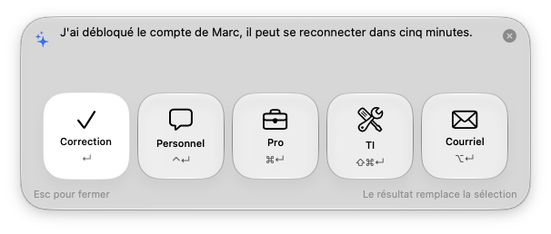
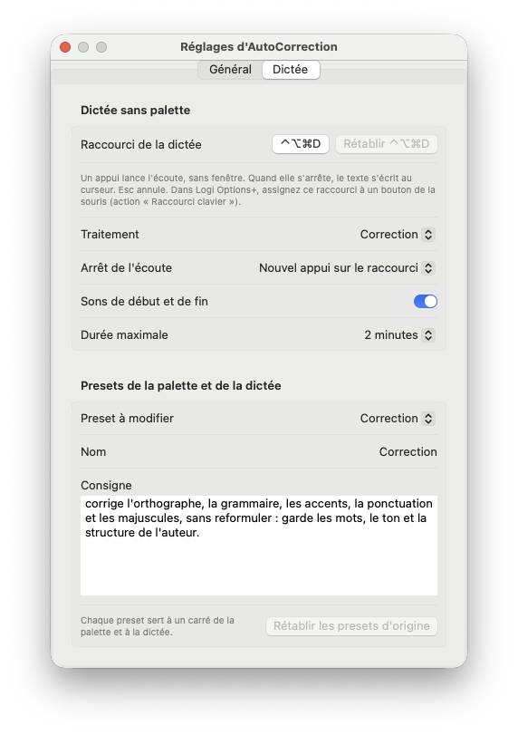

# AutoCorrection

Petite app Mac, dans la barre de menus, qui corrige ou réécrit (style personnel, professionnel, note TI, courriel) le texte sélectionné dans n'importe quelle app, ou le texte que vous dictez, grâce à Claude.



## Fonctions

- Raccourci global (⌥Espace par défaut, modifiable dans les réglages) qui ouvre une palette flottante sur le texte sélectionné.
- Palette claire ou sombre selon le Mac, au style Liquid Glass (macOS 26) ou Standard au choix dans les réglages, avec cinq gros carrés : Correction (↵), Personnel (⌃↵, ton naturel et amical), Pro (⌘↵, corriger et rendre professionnel), TI (⇧⌘↵, note de billet de soutien) et Courriel (⌥↵, style professionnel standard, français québécois, sans signature).
- Le texte sélectionné s'affiche en entier et se modifie avant l'action (⇧↵ pour un saut de ligne) : la zone grandit jusqu'à 12 lignes, puis défile.
- Dictée sans palette : un deuxième raccourci (⌃⌥⌘D par défaut) lance l'écoute (français) sans aucune fenêtre. Un nouvel appui l'arrête, ou un silence de 3, 5, 7 ou 10 secondes selon le réglage, puis le texte s'écrit à l'emplacement du curseur. Esc annule. Un son marque le début et la fin, et l'icône de la barre des menus devient un micro pendant l'écoute.
- Avec une souris Logitech : dans Logi Options+, donnez à un bouton l'action « Raccourci clavier » ⌃⌥⌘D. Options+ envoie une frappe instantanée, pas un maintien : c'est pourquoi la dictée se lance et s'arrête par deux appuis plutôt qu'en tenant le bouton.
- Presets : Correction, Style personnel, Style professionnel, Note TI et Courriel. Chacun sert à un carré de la palette et au traitement de la dictée, qui peut aussi être Brut (texte reconnu tel quel, sans IA). Nom et consigne modifiables dans l'onglet Dictée des réglages ; choix du traitement de la dictée aussi dans le menu « Traitement de la dictée ».
- Réglages en deux onglets. Général : moteur, raccourci de la palette, ouverture au démarrage du Mac, option pour cacher l'icône de la barre des menus (rouvrir l'app ouvre les réglages). Dictée : raccourci, traitement, arrêt de l'écoute, sons, durée maximale, presets.
- Menu « Rechercher les mises à jour… » : installe la dernière version publiée sur GitHub, après vérification de la signature.
- La palette se ferme avec le bouton ×, par un clic en dehors, ou avec Esc.
- Le résultat remplace la sélection, ou va dans le presse-papiers selon le réglage.
- Le presse-papiers d'origine est rétabli après chaque opération.
- Deux moteurs au choix : une clé API Anthropic, ou la commande `claude` de Claude Code (forfait Max, sans clé API).
- Clé API conservée dans le Trousseau ; modèle (Haiku 5.5, Sonnet 5.5 ou Opus 5.5), niveau de réflexion (faible par défaut) configurables.



## Installer

Télécharge [AutoCorrection.dmg](https://github.com/mdany75/AutoCorrection/releases/latest/download/AutoCorrection.dmg) (toujours la dernière version), ouvre-le, puis glisse AutoCorrection dans Applications.

Configuration requise : macOS 14 ou plus et soit une clé API Anthropic, soit Claude Code installé et connecté (bouton « Se connecter » dans les réglages, ou `claude auth login` dans le Terminal). Le moteur se choisit dans les réglages. Pour la dictée, macOS demande au premier usage l'accès au Microphone et à la Reconnaissance vocale. Au premier lancement, accorder l'autorisation Accessibilité (Réglages Système > Confidentialité et sécurité) pour que l'app puisse copier et coller le texte, puis saisir la clé dans les réglages.

## Reconstruire

Outils nécessaires : Swift 5.9 ou plus (outils en ligne de commande Xcode). Avec le certificat « Developer ID Application » et le profil `notarisation` de `notarytool`, l'image disque est signée et notarisée ; sinon, signature ad hoc.

```bash
./build.sh
```

Produit `build/AutoCorrection.app` et `build/AutoCorrection.dmg`. L'option `--install` installe aussi dans `/Applications`.

## Organisation

- `Sources/AutoCorrection/` : code Swift (palette, presse-papiers, client Claude, raccourci, réglages)
- `Resources/` : icône de l'app
- `scripts/` : génération de l'icône
- `build.sh` : compile et assemble l'app dans `build/`

## Licence

MIT, voir [LICENSE](LICENSE).
